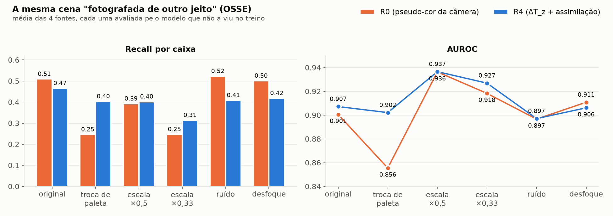
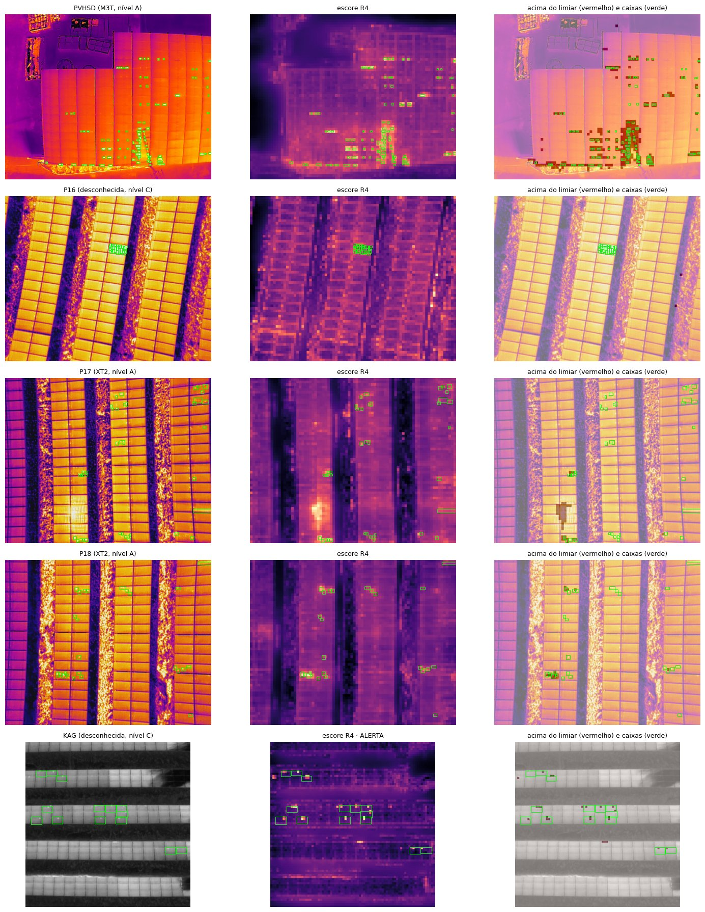
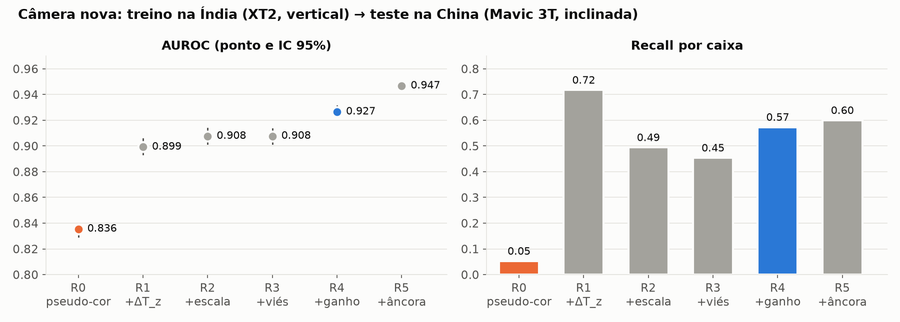
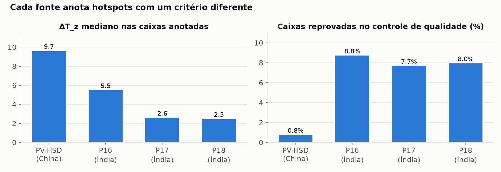

<div align="center">

# Hotspots em usinas solares com qualquer câmera

### Detectar defeitos em imagens térmicas de drone sem depender de qual câmera, lente ou paleta tirou a foto, usando ideias da assimilação de dados da previsão do tempo.

[](https://huggingface.co/RenatoSpessotto/thermal-pv-hotspots-assimilation)
[](solar_hotspots.ipynb)
[](pyproject.toml)
[](https://huggingface.co/facebook/dinov3-vitb16-pretrain-lvd1689m)

</div>

> **Projeto Final de SCC0287 (ICMC/USP).** Inspeção de usinas fotovoltaicas por drone com câmera térmica. O objetivo
> não é só detectar hotspots, mas detectá-los **numa câmera que o modelo nunca viu**.

Um **hotspot** é um pedaço de módulo solar mais quente que os vizinhos: célula trincada, diodo em curto, sujeira. Drones
com câmera térmica encontram esses defeitos, mas cada usina é fotografada de um jeito: outra câmera, outra altitude,
outro ângulo, outra paleta de cores. Um detector treinado numa usina perde muito desempenho na seguinte.

A ideia foi tratar isso como a previsão do tempo trata satélites diferentes: **separar o que é o fenômeno do que é o jeito
de observá-lo**. Em vez de mostrar ao modelo a imagem colorida da câmera, mostramos a temperatura relativa aos painéis
vizinhos, numa paleta e numa escala fixas, e corrigimos o viés que cada aquisição introduz na decisão.

| **5% → 57%** | **0,836 → 0,927** | **−52% × −13%** | **69%** |
|:---:|:---:|:---:|:---:|
| hotspots encontrados numa câmera nova (pseudo-cor → nosso modelo) | AUROC na câmera nova | queda do recall quando só a paleta da câmera muda (pseudo-cor × nosso modelo) | das imagens de uma fonte nunca vista marcadas como "fora do que o modelo conhece" (contra 1–3% no treino) |



> **Uso indicado: triagem.** O modelo ordena bem o que é suspeito (AUROC 0,86–0,98 na mesma usina), mas a **precisão é
> baixa**: no limiar padrão, uma parte grande das regiões marcadas não é hotspot anotado (precisão por célula ~0,3–0,45),
> e o recall por caixa varia de 0,38 a 0,74 entre usinas. Serve para apontar onde olhar, não para contar defeitos.
> A contribuição do trabalho é a **robustez à troca de câmera**, não a acurácia máxima numa usina conhecida; nisso um
> detector ajustado como o YOLO provavelmente é mais preciso. Detalhes em [docs/resultados.md](docs/resultados.md#10-desempenho-na-mesma-usina-e-precisão).

## Experimente
```bash
pip install -e .
export HF_TOKEN=...   # o DINOv3 é "gated": aceite a licença na página do modelo no Hugging Face
python exemplos/usar_modelo.py
```
```python
from solar_hotspots import analisar

r = analisar("modelo/exemplos/P17_A.jpg")
r["nivel"], r["cabeca"]   # ('A', 'R4'): imagem radiométrica → cabeça invariante à câmera
r["hotspots"]             # lista de caixas {x1, y1, x2, y2, escore} em pixels da imagem
r["alerta"]               # True se a imagem estiver fora do que o modelo viu no treino
r["mapa"]                 # escore (logit) por célula de 8×8 px
```
Aceita **qualquer JPEG térmico**: com temperatura (FLIR, DJI R-JPEG) usa o modelo invariante; só com a pseudo-cor, usa a
cabeça visual e avisa. Os pesos (~7 MB) estão em [`modelo/`](modelo) e no [Hugging Face](https://huggingface.co/RenatoSpessotto/thermal-pv-hotspots-assimilation).

## Como funciona


1. **Lê a temperatura de verdade**, não a cor. Os leitores radiométricos (FLIR FFF e DJI R-JPEG) são em Python puro, e
   cada imagem recebe um nível: **A** (temperatura + escala), **B** (temperatura sem escala) ou **C** (só pseudo-cor).
2. **Inverte o "operador de observação".** O ΔT_z é quanto cada ponto está acima dos painéis vizinhos, em desvios.
   Ele remove a calibração da câmera e o dia mais quente ou mais frio. Depois o ΔT_z é pintado numa **paleta fixa** e
   reamostrado para **3 cm/px**, a mesma escala para qualquer altitude ou lente.
3. **DINOv3 congelado** extrai as features; uma **regressão logística** decide célula a célula (8×8 px).
4. **Termos de assimilação de dados** somados à decisão:
   - **correção de viés** (como o VarBC dos centros meteorológicos) pelos metadados do voo: ângulo, escala, contraste, hora;
   - **ganho de Kalman**: o peso da evidência física (o ΔT_z) depende da qualidade da aquisição;
   - **viés de cada anotador**, ancorado num critério físico: cada dataset anota hotspots de um jeito diferente.
5. **Controle de qualidade dos rótulos:** caixas anotadas sem contraste térmico são rejeitadas, como observações com erro
   grosseiro.

O raciocínio completo, com as equações e as decisões tomadas por evidência: **[docs/metodologia.md](docs/metodologia.md)**.

## Resultados
Três formas de testar se a câmera deixou de importar:

**1. Câmera nova.** Treino só nas usinas da Índia (FLIR XT2, voo vertical); teste na China (DJI Mavic 3T, voo inclinado,
telhados). Cada etapa de assimilação melhora o resultado, e o modelo final recupera **62%** da perda de desempenho:



**2. A mesma imagem "fotografada de outro jeito"** (figura no topo). Trocar só a paleta de cores derruba pela metade o
recall do modelo que vê a pseudo-cor; o nosso quase não muda. Ruído e desfoque não afetam nenhum dos dois. Voar 3× mais
alto prejudica os dois: é o limite físico, já que o hotspot fica menor que um pixel.

**3. Cada dataset anota de um jeito.** Os anotadores da China marcam hotspots fortes; os da Índia, também os fracos. O
controle de qualidade e o viés por anotador tornam isso mensurável:



| Teste | Pseudo-cor da câmera (R0) | **Nosso modelo (R4)** |
|---|---|---|
| Câmera nova: AUROC / recall | 0,836 / 0,05 | **0,927 / 0,57** |
| Troca de paleta: recall | 0,51 → 0,25 | **0,47 → 0,40** |
| Mesma câmera, outra usina: AUROC | **0,91–0,95** | 0,90–0,91 |
| Sem radiometria (web): AUROC | **0,79** | 0,71 |

**A conclusão é uma regra:** com temperatura, o modelo com assimilação é o que não depende da câmera; sem temperatura,
a pseudo-cor da própria câmera é a melhor informação que existe. O pacote escolhe sozinho pelo tipo de imagem. Todas as
tabelas, com intervalos de confiança: **[docs/resultados.md](docs/resultados.md)**.

## Estrutura
```
├── solar_hotspots.ipynb    o experimento completo, executado (Colab A100, ~1,5 h): dados → features → cabeças → testes
├── src/solar_hotspots/     pacote de inferência: analisar(imagem)
├── modelo/                 pesos (safetensors), config.json e imagens de exemplo
├── resultados/             CSVs de todos os testes (por fold, por perturbação, por imagem)
├── exemplos/               uso mínimo do pacote
└── docs/
    ├── metodologia.md      o raciocínio: assimilação de dados, cada termo, inconsistências, decisões, limitações
    ├── resultados.md       todas as tabelas com IC 95%
    ├── dados.md            as fontes, a preparação e as licenças
    ├── historico.md        v1 → v2 → versão final: o que cada versão ensinou
    └── model_card.md       o card do modelo no Hugging Face
```

**Reproduzir:** abra `solar_hotspots.ipynb` no Colab com GPU, configure o secret `HF_TOKEN` com acesso ao DINOv3 e
*Executar tudo*. O notebook baixa os dados (Hugging Face, Kaggle, Zenodo), prepara tudo e salva cache no Drive; se a
sessão cair, ele continua de onde parou.

## Limitações
- **Precisão baixa no limiar padrão** (ver o aviso no topo): uso recomendado é triagem. Próximos passos: agrupar
  células em componentes com o tamanho físico de um hotspot, limiar por tipo de imagem e um híbrido com YOLO.
- **Duas câmeras radiométricas com rótulo** (FLIR XT2 e DJI Mavic 3T). Uma terceira (Zenmuse XT, Colômbia) ficou de fora
  porque o servidor recusou o download automático.
- **O limiar não se transfere perfeitamente** entre câmeras: na câmera nova o modelo marca mais falsos positivos.
- **Sem temperatura, a invariância não vale**: por isso o pacote usa a cabeça visual nessas imagens.
- **Hotspots menores que um pixel** (voo muito alto) não são recuperáveis por nenhuma normalização.

**Dados e licenças.** PV-HSD-2025 e as usinas da Índia (Apache-2.0); máscara de painel no dataset do Zenodo
(CC BY 4.0); teste no agregado do Kaggle (CC BY-NC 4.0). O DINOv3 tem licença própria da Meta e é baixado do Hugging
Face. Detalhes em [docs/dados.md](docs/dados.md).

**Referência central:** Lahoz, W. A. & Schneider, P. (2014). *Data assimilation: making sense of Earth Observation.*
Frontiers in Environmental Science 2:16.

---

## English summary
**Detecting hotspots in solar plants from drone thermal imagery, independently of the camera that took the picture.**
A detector trained on one plant usually degrades on the next one because each plant is imaged with a different camera,
lens, altitude, angle and color palette. Borrowing from weather-forecast **data assimilation**, we separate the
phenomenon from the way it was observed: the model sees the radiometric temperature relative to neighboring panels
(ΔT_z), painted in a fixed palette at a fixed 3 cm/px scale, and a logistic head on frozen **DINOv3** features adds a
VarBC-style bias correction on acquisition metadata, a Kalman-style gain on the physical evidence, and per-annotator
biases anchored on a physical criterion. On an unseen camera (train: India/FLIR XT2 nadir → test: China/DJI Mavic 3T
oblique) AUROC goes from 0.836 to 0.927 and box recall from 5% to 57%; swapping only the color palette halves the recall
of the pseudo-color model but barely moves ours. Without radiometry, the camera's pseudo-color remains the best signal,
so the package picks the head by input type. Methodology, all results with 95% CIs, and the model card are in `docs/`.
