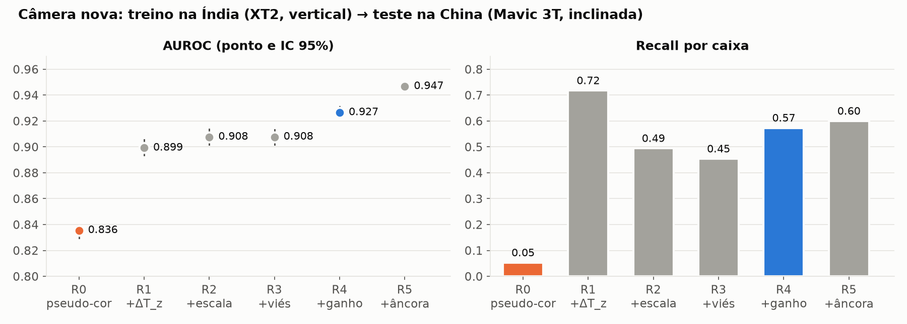
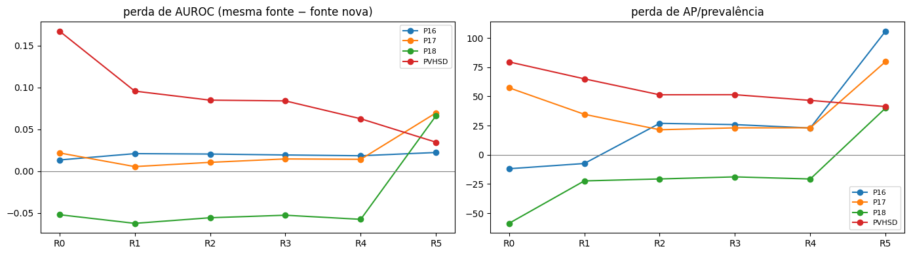
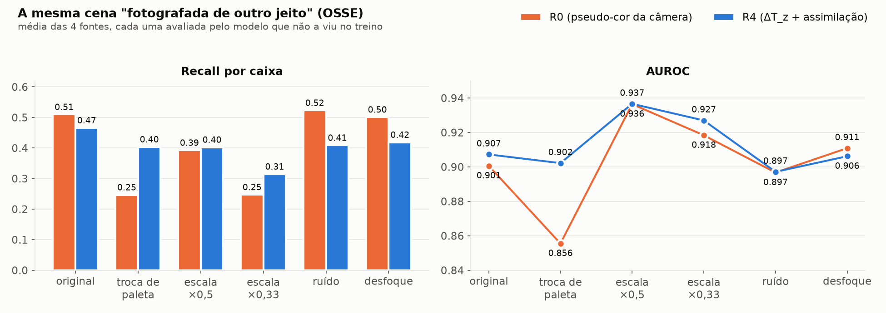
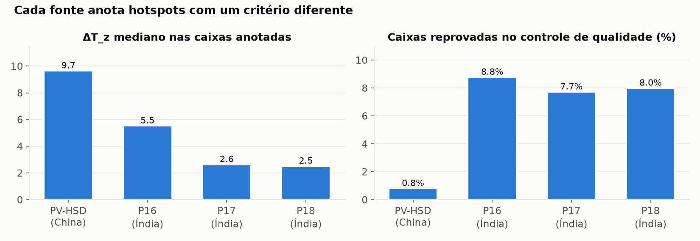

# Resultados

Todos os números saem de [`resultados/`](../resultados) (execução completa no Colab, A100, DINOv3-B/16, 6.078 imagens) e
foram conferidos no MCP de ciência de dados. AUROC e AP são por célula de 8×8 px; IC 95% por bootstrap sobre imagens.
As 3 sementes deram resultados idênticos (o L-BFGS em lote completo é determinístico), então os números são da semente 0.

**Cabeças:** R0 = pseudo-cor da câmera · R1 = + ΔT_z · R2 = + escala 3 cm/px · R3 = + viés VarBC · R4 = + ganho de Kalman ·
R5 = + viés de anotação por fonte com âncora física. Detalhes em [metodologia.md](metodologia.md#5-a-cabeça).

## Sumário
1. [Câmera nova (o teste principal de OSE)](#1-câmera-nova)
2. [Todas as fontes deixadas de fora](#2-todas-as-fontes-deixadas-de-fora-loso)
3. [Quanto da perda cada etapa recupera](#3-quanto-da-perda-cada-etapa-recupera)
4. [Invariância por perturbação (OSSE)](#4-invariância-por-perturbação-osse)
5. [Fonte sem radiometria (KAG) e alerta de fora de suporte](#5-fonte-sem-radiometria-kag-e-alerta-de-fora-de-suporte)
6. [Controle de qualidade](#controle-de-qualidade)
7. [O que a assimilação aprendeu](#7-o-que-a-assimilação-aprendeu)
8. [O que não deu certo](#8-o-que-não-deu-certo)
9. [Conclusão e a regra publicada](#9-conclusão-e-a-regra-publicada)
10. [Desempenho na mesma usina e precisão](#10-desempenho-na-mesma-usina-e-precisão)

---

## 1. Câmera nova
Treino só nas usinas da Índia (FLIR XT2, voo vertical, ~3 cm/px) → teste na China (DJI Mavic 3T, voo inclinado, telhados).

| | R0 | R1 | R2 | R3 | **R4** | R5 |
|---|---|---|---|---|---|---|
| AUROC | 0,836 | 0,899 | 0,908 | 0,908 | **0,927** | 0,947 |
| IC 95% | 0,830–0,839 | 0,894–0,906 | 0,902–0,914 | 0,902–0,913 | **0,923–0,931** | 0,945–0,949 |
| AP / prevalência | 8,3 | 22,6 | 31,4 | 31,1 | **41,6** | 40,9 |
| Recall por caixa | **0,05** | 0,72 | 0,49 | 0,45 | **0,57** | 0,60 |
| FP por imagem | 3,1 | 172,7 | 30,4 | 24,8 | 34,0 | 32,2 |

- O R0 praticamente **não encontra os hotspots** numa câmera que não viu (5% das caixas).
- A inversão radiométrica sozinha (R1) já recupera a maior parte; cada etapa seguinte melhora a AUROC, com IC sem
  sobreposição entre R0 e R4.
- Custo: o R4 marca mais células falsas por imagem que o R0 (34 × 3), porque o limiar foi escolhido na validação das
  usinas da Índia.

## 2. Todas as fontes deixadas de fora (LOSO)
AUROC (IC 95%):

| Fonte de teste | Câmera do teste está no treino? | R0 | R2 | R4 | R5 |
|---|---|---|---|---|---|
| PV-HSD (China) | **não** (Mavic 3T) | 0,836 (0,830–0,839) | 0,908 (0,902–0,914) | **0,927** (0,923–0,931) | 0,947 (0,945–0,949) |
| P16 (Índia) | sim (XT2 de P17/P18) | **0,952** (0,946–0,958) | 0,908 (0,895–0,919) | 0,911 (0,900–0,922) | 0,866 (0,852–0,878) |
| P17 (Índia) | sim | **0,911** (0,902–0,919) | 0,898 (0,891–0,906) | 0,898 (0,892–0,906) | 0,838 (0,827–0,848) |
| P18 (Índia) | sim | **0,920** (0,912–0,930) | 0,896 (0,879–0,913) | 0,899 (0,881–0,915) | 0,801 (0,781–0,821) |

Recall por caixa e AP/prevalência:

| Fonte de teste | R0 recall | R4 recall | R0 AP/prev | R4 AP/prev |
|---|---|---|---|---|
| PV-HSD | 0,05 | **0,57** | 8,3 | **41,6** |
| P16 | **0,84** | 0,53 | **208,8** | 125,7 |
| P17 | **0,63** | 0,41 | **85,9** | 52,4 |
| P18 | **0,49** | 0,35 | **65,9** | 49,5 |

**Leitura:** quando a câmera do teste **é a mesma** de outras fontes de treino (as três usinas da Índia usam XT2), o R0
aproveita a aparência dessa câmera e vai melhor. Quando a câmera **muda** (PV-HSD), o R0 desaba e o R4 se mantém. Na
mesma fonte (IN-X), todas as cabeças ficam próximas (PV-HSD ≈ 0,98 em todas).

## 3. Quanto da perda cada etapa recupera
Perda de AUROC = mesma fonte (IN-X) − fonte nunca vista (LOSO-X), **nas mesmas imagens de teste**:

| Fonte | R0 | R1 | R2 | R3 | R4 | R5 |
|---|---|---|---|---|---|---|
| **PV-HSD (câmera nova)** | 0,167 | 0,096 | 0,085 | 0,084 | **0,063** | 0,035 |
| P16 | 0,013 | 0,021 | 0,021 | 0,019 | 0,018 | 0,022 |
| P17 | 0,022 | 0,006 | 0,011 | 0,015 | 0,014 | 0,070 |
| P18 | −0,052 | −0,062 | −0,056 | −0,053 | −0,057 | 0,066 |

Na câmera nova, o R4 recupera **62%** da perda do R0 e o R5, **79%**. Nas usinas da Índia a perda já é pequena; no P18 é
negativa porque a referência IN-P18 treina com poucas imagens (200 no total).

## 4. Invariância por perturbação (OSSE)
A mesma imagem rotulada "fotografada de outro jeito", avaliada pelo modelo do fold em que a fonte ficou de fora.

Média das 4 fontes:

| Perturbação | Recall R0 | Recall R4 | AUROC R0 | AUROC R4 |
|---|---|---|---|---|
| original | 0,51 | 0,47 | 0,901 | 0,907 |
| **troca de paleta** | **0,25** (−52%) | 0,40 (−13%) | **0,856** | 0,902 |
| escala ×0,5 | 0,39 | 0,40 | 0,936 | 0,937 |
| escala ×0,33 | 0,25 | 0,31 | 0,918 | 0,927 |
| ruído (0,2 °C) | 0,52 | 0,41 | 0,897 | 0,897 |
| desfoque (σ = 1 px) | 0,50 | 0,42 | 0,911 | 0,906 |

Recall por fonte:

| Fonte | Perturbação | R0 | R4 |
|---|---|---|---|
| PV-HSD | original / paleta / escala ×0,33 | 0,07 / 0,05 / 0,03 | 0,56 / **0,57** / 0,24 |
| P17 | original / paleta / escala ×0,33 | 0,65 / **0,25** / 0,29 | 0,46 / **0,45** / 0,36 |
| P18 | original / paleta / escala ×0,33 | 0,49 / **0,23** / 0,22 | 0,35 / **0,34** / 0,28 |
| P16 | original / paleta / escala ×0,33 | 0,83 / **0,45** / 0,46 | 0,49 / 0,26 / 0,38 |

- **Troca de paleta:** o R0 perde metade do recall; o R4 fica estável nas fontes radiométricas (PV-HSD, P17, P18).
- **P16 é a exceção que confirma a regra:** 75% das imagens do P16 são de nível C (só a imagem embutida no JSON, sem
  radiometria). Nelas o ΔT_z vem da luminância da paleta, e o R4 também sente a troca. A invariância vale para imagens
  com temperatura.
- **Escala ×0,33** derruba o recall das duas cabeças: é o limite físico de resolução (hotspot menor que um pixel).
  O AUROC sobe um pouco com a redução de escala (provavelmente porque a imagem reduzida suaviza o fundo e as células
  vizinhas passam a compartilhar pixels; não foi testado à parte); o recall por caixa é a métrica que mostra a perda.
- **Ruído e desfoque:** as duas cabeças ficam estáveis.

## 5. Fonte sem radiometria (KAG) e alerta de fora de suporte
KAG: 349 imagens originais de um agregado da web (Roboflow/Kaggle), redimensionadas para 640×640, sem metadados nem
temperatura (nível C), avaliadas pelo modelo treinado em todas as fontes.

| | R0 | R1 | R2 | R4 | R5 |
|---|---|---|---|---|---|
| AUROC (IC 95%) | **0,790** (0,757–0,824) | 0,713 | 0,695 | 0,709 (0,653–0,754) | 0,710 |
| Recall por caixa | **0,92** | 0,71 | 0,86 | 0,85 | 0,00 |

Sem radiometria, a vantagem do R4 desaparece e o R0 é melhor. Daí a regra C → R0.

**Alerta de fora de suporte** (Mahalanobis do embedding R2, limiar no percentil 99 do treino):

| Fonte | Imagens | Marcadas como fora de suporte | Distância mediana |
|---|---|---|---|
| PV-HSD | 4.023 | 0,9% | 14,2 |
| P16 | 494 | 2,8% | 13,5 |
| P17 | 659 | 2,6% | 12,0 |
| P18 | 200 | 1,0% | 12,8 |
| **KAG** (nunca vista) | 349 | **69,3%** | 22,6 |

O alerta separa bem as imagens que o modelo conhece das que não conhece.

## Controle de qualidade

| Fonte | Caixas (radiométricas) | Reprovadas | ΔT_z mediano |
|---|---|---|---|
| PV-HSD | 25.177 | 0,8% | 9,7 |
| P16 | 467 | 8,8% | 5,5 |
| P17 | 2.031 | 7,7% | 2,6 |
| P18 | 775 | 8,0% | 2,5 |

Os anotadores do PV-HSD marcam hotspots fortes; os da Índia marcam também hotspots fracos. Efeito do QC nas métricas
(com QC − todas as caixas, LOSO): AUROC +0,000 a +0,006; recall do R4 +0,005 a +0,030. Pequeno, mas sempre a favor.

## 7. O que a assimilação aprendeu
Modelo final (treinado em todas as fontes), cabeça R5:

| Preditor | β (viés, logit) | b_obs (+ = observação física pior) |
|---|---|---|
| 1 − cos(visada) | −0,106 | −0,067 |
| log(GSD/3) | 0,255 | 0,022 |
| log(MAD/MAD_ref) | 0,627 | 0,044 |
| sen(hora) | 0,030 | −0,024 |
| cos(hora) | 0,832 | 0,022 |
| falta_geometria | 1,005 | 0,027 |
| falta_hora | 1,206 | 0,000 |
| nível C | 1,206 | 0,000 |

- **Ganho K(m):** 1,22–1,35 em todas as fontes de treino (média 1,25–1,29). A confiança na evidência física varia
  pouco com a aquisição dentro do suporte de treino: os `b_obs` são todos pequenos.
- **Viés:** imagens com mais contraste de cena (MAD) e sem metadados recebem um deslocamento positivo no logit.

Critério de anotação de cada fonte em relação à âncora física (α = γ = 0):

| Fonte | α (intercepto) | γ (sensibilidade ao ΔT_z) |
|---|---|---|
| PV-HSD | 1,65 | −1,16 |
| P16 | −0,10 | −0,54 |
| P17 | 1,29 | −1,16 |
| P18 | 1,70 | −1,12 |

γ negativo em todas: os anotadores dependem **menos** do contraste térmico do que o critério físico. O P16 é o mais
próximo da âncora.

## 8. O que não deu certo
- **R5 como cabeça padrão.** Ele é o melhor na câmera nova (0,947) porque decide pelo critério físico estrito, e no
  PV-HSD os hotspots anotados são fortes. Mas na Índia, onde os anotadores marcam hotspots fracos, o recall cai para
  0,05–0,08, e no KAG (sem temperatura) para zero. Fica disponível no pacote como opção ("critério físico"), não como
  padrão.
- **Calibração do limiar entre câmeras:** o R4 marca ~34 células falsas por imagem na China.
- **ALF (câmera nova sem rótulo):** ficou fora da execução final (download recusado pelo servidor).
- **Homografia** (seção 10 da metodologia) e **FOV pela periodicidade**: descartados por evidência.

## 9. Conclusão e a regra publicada
Com radiometria, **inverter o operador de observação torna a decisão independente da câmera**: na câmera nova a AUROC
sobe de 0,836 para 0,927 e o recall de 5% para 57%; na troca de paleta, o R4 perde 13% do recall e o R0, 52%. Sem
radiometria, a pseudo-cor da câmera é a única informação, e o R0 vai melhor. O pacote decide pela imagem:

| Nível da imagem | Cabeça |
|---|---|
| A (radiométrica com escala) | **R4** |
| B (radiométrica sem escala) | **R4** |
| C (só pseudo-cor) | **R0** |

## 10. Desempenho na mesma usina e precisão
Teste **IN** (treino e teste na mesma usina, em voos separados), cabeça R4:

| Usina | Imagens de teste | AUROC | AP por célula | Recall por caixa (IC 95%) | Células falsas por imagem |
|---|---|---|---|---|---|
| PV-HSD | 776 | 0,984 | 0,57 | 0,74 (0,71–0,76) | 10,7 |
| P17 | 126 | 0,946 | 0,25 | 0,72 (0,63–0,77) | 7,5 |
| P18 | 48 | 0,862 | 0,12 | 0,69 (0,57–0,78) | 56,7 |
| P16 | 80 | 0,932 | 0,27 | 0,38 (0,22–0,51) | 2,3 |

**Por que AUROC alta e recall baixo convivem.** Cada imagem tem ~5.120 células e ~12 de hotspot. No P16 como fonte
não vista (LOSO-P16, R4, 494 imagens; o IN-P16 se comporta igual),
só 1% das células normais passam do escore típico de um hotspot, o que dá AUROC alta; mas 1% de ~5.100 são ~50 células
por imagem, quatro vezes o número de hotspots. Todo limiar é uma troca:

| Limiar (logit) | Células de hotspot achadas | Células normais marcadas por imagem | Precisão por célula |
|---|---|---|---|
| 6,0 | 24% | 2 | 0,57 |
| **4,7 (escolhido na validação)** | **31%** | **5** | **0,40** |
| 3,0 | 41% | 17 | 0,22 |
| 1,0 | 57% | 117 | 0,05 |
| 0,0 | 69% | 334 | 0,02 |

**Comparação com o YOLO (só indicativa).** No v2, um YOLOv8s-P2 ajustado (60 épocas) teve, na validação das próprias
fontes de treino, precisão ~0,72 e recall ~0,68 por caixa (IoU ≥ 0,5). O recall por caixa do R4 na mesma usina é da mesma
ordem, mas com um critério mais frouxo (basta uma célula da caixa acima do limiar), e a precisão por caixa não foi
medida. A comparação justa (YOLO no mesmo protocolo de câmera nova e perturbações) fica como trabalho futuro.

**Conclusão:** o modelo é bom para ordenar e apontar regiões suspeitas e robusto à troca de câmera, mas não é um detector
preciso. Próximos passos: componentes conexas filtradas pelo tamanho físico de um hotspot, limiar por tipo de imagem,
cabeça não linear, e um híbrido em que este modelo faz a triagem e um detector ajustado confirma.
